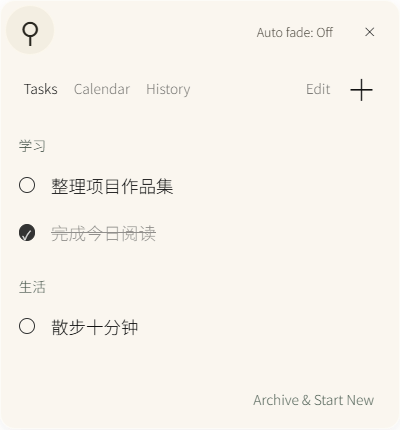
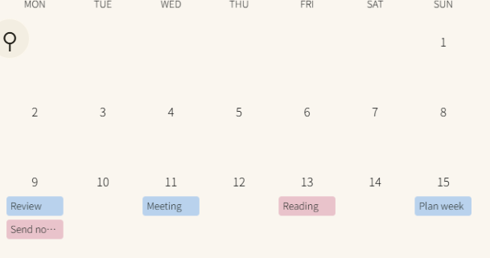

# TODO · Windows 桌面浮窗

一个从桌面小图标展开的本地待办与日历工具。米白色面板和图钉、磨砂效果，可选鼠标移开后的淡化。当前为个人项目体验版。

**[下载 Windows x64 免安装版](https://github.com/H071004/todo-desktop-public/releases/download/v1.0.0-preview.6/TODO-1.0.0-preview.6-Windows-x64.zip)**

解压整个压缩包，双击其中的 TODO.exe。

## 界面

截图来自实际 Windows 打包程序，使用隔离的展示数据；首次启动没有预置任务。




## 功能

- 悬停展开、移开收起；按所在屏幕左右位置向内展开；点击图钉固定，再点解除；固定后仍可拖动。
- 任务完成切换、分区选择及管理、Edit/Done、删除后短暂 Undo。Tasks 只显示有任务的分区；空分区仍可在 Edit 中管理，也可在 Section 菜单中选用。分区颜色可选。
- 在 Tasks 点击 Archive & Start New，再点 Confirm archive。保存成功后自动进入 History，并显示归档数量；新一轮保留分区。没有任务时按钮变灰并显示提示；保存失败时当前任务保留，可以重试。History 中可以把单条任务复制回 Tasks，副本默认为未完成。
- 月历从周一到周日排列。日期与星期标题对齐，事件从固定日期行下方排列。独立日历事件，可填日期、时间、地点；标签增删改色，支持多标签任意匹配与 Untagged。
- 自动本地保存，不需要账户。无联网同步、提醒或云备份。

## 软件下载与使用

在 [Windows x64 体验版 v1.0.0-preview.6](https://github.com/H071004/todo-desktop-public/releases/tag/v1.0.0-preview.6) 下载 `TODO-1.0.0-preview.6-Windows-x64.zip`。同页附 SHA256 校验文件。

解压整个压缩包到可写文件夹，双击 TODO.exe。不要单独移动 exe，其他文件为必需运行时。无需安装 Node.js 或开发工具。启动后不显示任务栏按钮，右下角系统托盘保留 TODO 图标（可能在隐藏图标中）。左键点击托盘图标或选择 Show TODO 显示浮窗；Reset Position 仅恢复可见位置，保留全部内容。Quit 完整退出，右上角 × 也退出。重复启动会唤回已有实例。

实际测试环境为 Windows 11 64 位、x64 构建；Windows 10、ARM64、32 位尚未测试，不宣称支持。未签名，可能出现系统信誉提示；请核对发布来源与 SHA256，不建议关闭安全保护。

数据存放在当前 Windows 用户的 `%APPDATA%/floating-todo-widget`，不写进程序包。不同 Windows 用户各自保存数据；同一用户的开发版和体验版共用此目录。升级请先备份数据，不要同时运行多份程序。

## 开发启动

使用已验证的 Node.js 26 与 npm 11 环境：

```sh
npm ci
npm start
```

Electron 的实际锁定版本见 package-lock.json。本次未升级依赖。

构建 Windows x64 体验目录（在 Windows 上执行）：

```powershell
powershell -ExecutionPolicy Bypass -File scripts/build-windows.ps1
```

脚本复用项目 Electron 的 Windows x64 运行时，仅复制明确列出的源文件及字体；不复制用户资料、Git、依赖目录或日志。输出目录 dist 不提交 Git。

## 技术与开发过程

Electron 提供真实置顶桌面窗口和窗口位置控制；原生 HTML/CSS/JavaScript 负责交互，preload 只开放必要的桌面操作。localStorage 保存任务、分区、历史、日历与标签，并兼容早期保存格式。

本项目使用 AI 辅助编码。需求提出、使用体验反馈与视觉取舍由项目作者推进，AI 协助实现、排查和编写自动验证。迭代包括图标锚点、固定与拖动冲突、输入焦点保护、标签筛选和归档保存顺序。它是持续打磨的个人作品，不是经过全面兼容认证的成熟产品。

## 验证与限制

已在 Windows 11 x64 上从免安装产物验证启动和重启恢复。preview.6 使用独立示例验证了删除或移走最后一条任务、归档后重用分区、设置和清除分区颜色，以及 11 月 9–15 日有零条、一条和多条事件时的日期对齐。实际中文输入法候选窗口、原生颜色选择器、多显示器不同缩放、长时间连续拖动仍需要人工验收。透明窗口的磨砂效果受 Windows 和显卡环境影响。

本地存储不加密，无导出或自动备份功能。卸载/清理用户资料可能丢失记录。当前未提供自动更新、代码签名和崩溃恢复保证。

## 许可

源码采用 [MIT License](LICENSE)。第三方字体与 Electron 依其各自许可证分发，见 [第三方说明](THIRD_PARTY_NOTICES.md)。

